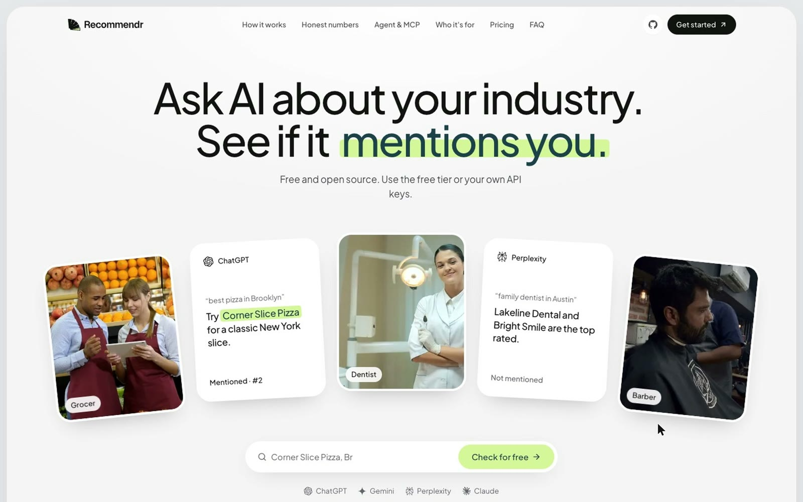
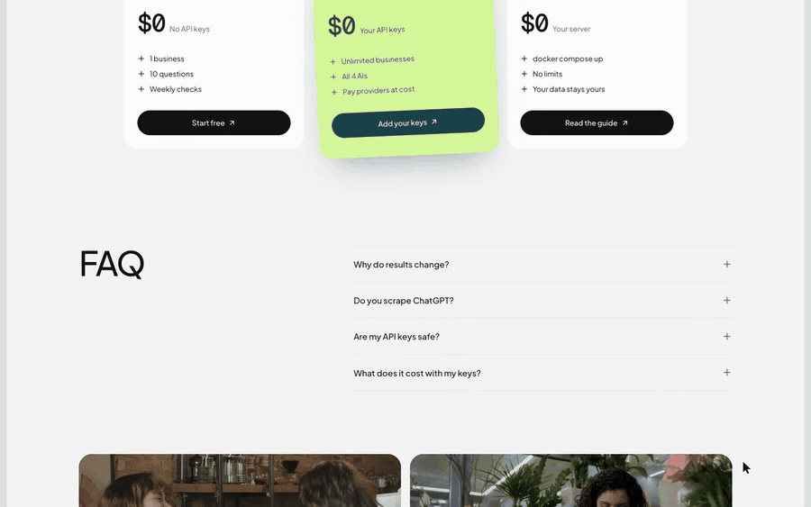

<p align="center">
  <picture>
    <source media="(prefers-color-scheme: dark)" srcset="docs/media/logo-full-white.svg">
    
  </picture>
</p>

<p align="center"><strong>See whether ChatGPT, Gemini, Perplexity and Claude recommend your business, and fix it.</strong></p>

<p align="center">
  <a href="docs/media/recommendr-demo.mp4">
    
  </a>
  <br>
  <a href="docs/media/recommendr-demo.mp4"><strong>▶ Watch the product video</strong></a> (1:43)
  <br>
  <sub>Design preview with sample data for a fictional pizzeria.</sub>
</p>

<p align="center">
  
</p>

> **Work in progress.** Phase 1 (scaffold and design documentation) is done; nothing below works
> yet. Follow along in [`docs/system-design.md`](docs/system-design.md).

Recommendr is a **free, open-source alternative to Profound and Peec AI** for small businesses,
local businesses and agencies. More and more customers ask an AI assistant, not a search engine,
"who's the best dentist near me?" or "which CRM should a small agency use?". Recommendr shows you:

- **Whether AI recommends you**, on which questions and engines, with honest confidence intervals
  (AI answers vary; we sample and tell you how sure we are).
- **Who gets recommended instead, and why:** the sources AI cites and the attributes it
  associates with your competitors.
- **False facts AI states about you:** wrong hours, prices, locations or services, checked
  against facts you've verified.
- **What to fix:** an AI-readiness audit of your site (AI crawler rules, JSON-LD, llms.txt, FAQs)
  and a prioritized fix plan with ready-to-use drafts.
- **Alerts that mean something:** only statistically significant changes, never sampling noise.
- **Agents and MCP:** ask your data in plain language (every number cited), or connect your own
  agents through the MCP server.

### Free, three ways

| | |
|---|---|
| **Free tier** | 1 project, 10 questions, weekly checks on 2 engines, no API keys needed |
| **Bring your own keys** | Add your OpenAI, Gemini, Perplexity and Anthropic keys: all engines, your cadence, you pay providers directly at cost. Keys are encrypted and never shown again |
| **Self-host** | `docker compose up` on your own machine, BYOK, no limits |

## Screenshots

_Coming in phase 8 (dashboard)._

<!-- screenshots: dashboard overview, competitor gaps, false facts, fix plan -->

## Self-host in 5 minutes

_Completed in the deployment phase. Planned flow:_

```sh
git clone https://github.com/saadhtiwana/recommendr.git && cd recommendr
cp backend/.env.example .env        # set KEY_ENCRYPTION_KEY, SESSION_SECRET, DEPLOYMENT_MODE=self_hosted
docker compose up -d
open http://localhost:3000          # add your provider keys in Settings → API keys
```

See [`docs/self-hosting.md`](docs/self-hosting.md).

## How it works

A modular monolith (FastAPI + Postgres) running as API, worker and scheduler processes, plus a
Next.js frontend. The parts that are hard, and that are worth reading about:

- **Statistics:** Wilson score intervals, adaptive sampling with a documented stopping rule,
  two-proportion tests with Benjamini-Hochberg false discovery control.
- **Cost:** a shared observation layer (identical public questions are sampled once and shared,
  never private data), budget reservations, AIMD rate control per provider key.
- **Reliability:** durable workflows on Postgres with leases, fencing tokens, a transactional
  outbox and weighted fair scheduling across tenants.
- **Security:** Row-Level Security for tenant isolation, an envelope-encrypted key vault,
  SSRF-hardened crawling, and prompt-injection defenses for agents.

| Doc | |
|---|---|
| [System design](docs/system-design.md) | Requirements, capacity and cost estimates, architecture, deep dives, failure modes, scaling |
| [Architecture decision records](docs/adr/README.md) | 30 ADRs: every significant decision, with alternatives |
| [Product spec](docs/product-spec.md) | Personas, journeys, plans and limits, agents and MCP |
| [Self-hosting](docs/self-hosting.md) | Docker Compose setup (skeleton) |

## Repository layout

| Path | |
|---|---|
| `backend/` | FastAPI app (Python 3.12, uv): API, worker, scheduler |
| `web/` | Next.js (App Router, TypeScript strict, Tailwind, pnpm) |
| `evals/` | Golden datasets, extraction and agent evaluation harness |
| `docs/` | Design documentation |
| `render.yaml` | Render Blueprint for the hosted instance (later) |

## Contributing

Contributions are welcome. See [CONTRIBUTING.md](CONTRIBUTING.md) and the
[Code of Conduct](CODE_OF_CONDUCT.md). Report security issues privately per
[SECURITY.md](SECURITY.md).

## License

[AGPL-3.0-or-later](LICENSE). Copyright © 2026 Malik Saad Hayat (see [NOTICE](NOTICE)).
If you run a modified version as a network service, the AGPL requires you to offer your
modifications' source to its users.

_Recommendr is not affiliated with OpenAI, Google, Perplexity, Anthropic, Profound or Peec AI._
